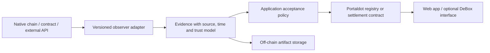

# Portaldot Hacker House 2026: research and twelve build proposals

Research completed 24 October 2026. Scope: the October–November Hacker House linked by the user, not the earlier Mini Hackathon S1. Three parallel research investigations covered the runtime, partners, and node/DApp opportunities; a separate review challenged feasibility and novelty.

**Recommendation:** shortlist Runtime Passport for developer infrastructure, FinalityFlight for node tooling, RightRelay for a manageable cross-chain product, and MeterMend or ReproPay for a DApp. Continuity Vault is another strong choice for a team that prefers backend/product work. Resolve the official V3 testnet deployment path before choosing an implementation language or making cross-runtime integration essential.

These are researched product proposals, not implemented projects, customer-validated businesses, or guarantees of winning. The implementation scopes assume an experienced two- or three-person team and roughly twelve focused build days. A solo builder should retain one contract environment, one user journey and one optional partner.

## What the brief actually rewards

The brief weights technical feasibility and innovation at 30% each, ecosystem contribution and business potential at 20% each. Its 5,200-USDT-equivalent pool is split equally between USDT and POT. Grand prize is 1,000; four track first prizes are 800 each; DApp second/third are 500/300; community choice is 200. Grand prize replaces a same-project track first prize; community choice can stack. Awards depend on project quality. [Brief mirror](https://www.hackathonradar.com/database/hackathon/portaldot-hacker-house-2026).

The organizer asks entrants to choose one primary track. Middleware should become reusable developer infrastructure; cross-chain entries should deliver interoperability infrastructure; node tools should improve operational quality; DApps should produce repeated useful interactions and measurable users. Extra integrations support that core story. [Organizer track explanation, accessed through a public mirror](https://boldnet.twstalker.com/PortaldotL0/status/2108611245314072679).

Required delivery includes Portaldot testnet usage, public reproducible code and documentation, a runnable demo, a video of at most three minutes, deployment evidence and a pitch. Maintain genuine development history: at least three valid commits, with core development spread through the event rather than uploaded in the last day. Code freeze follows submission. [Brief mirror](https://www.hackathonradar.com/database/hackathon/portaldot-hacker-house-2026).

**Access limitation:** the requested [DoraHacks page](https://dorahacks.io/hackathon/portaldot-hacker-house-2026/detail) returned a verification block. We cross-checked its public mirror, [DoraHacks' Eventbrite listing](https://www.eventbrite.com/e/portaldot-hacker-house-2026-tickets-2002321816454), and organizer announcements. Private Discord updates and unpublished bounty sheets were not accessible.

## Dates that affect the decision

The published check-in was **October 24 at 13:00 Lagos/WAT** and had already passed when this research ran. It expected a demonstrable prototype. If the team has not checked in, eligibility needs organizer clarification; acceptance after that deadline is not established. Final submission remains **November 6 at 05:00 WAT** in the latest material found. [Brief mirror](https://www.hackathonradar.com/database/hackathon/portaldot-hacker-house-2026).

A later organizer update supersedes several dates still shown by aggregators:

| Milestone | Latest located schedule |
|---|---|
| Apply for office hours | October 27, 13:00 WAT |
| Office hours | October 28–29; confirm session times |
| Live demos | November 8–9 |
| Community voting | November 9, 17:00–November 10, 17:00 WAT |
| Winner announcement | November 11 |
| Reward distribution | November 14, 13:00 WAT |

Source: [organizer timeline update, mirrored](https://boldnet.twstalker.com/PortaldotL0/status/2109577148109381814), [original post](https://x.com/PortaldotL0/status/2109577148109381814). The full schedule and evidence notes are in [brief research](research/brief-and-prior-art.md).

## Technology findings: what we can responsibly build around

### Portaldot's important opportunity is the boundary between its components

Portaldot advertises WASM/ink! alongside EVM-compatible execution through Revive. Its existing native runtime exposes modules for assets, identity, staking, batching, proxies, multisig and contracts. Those can support products that combine application contracts with native chain operations. However, deploying a contract, calling a native pallet, and installing a new pallet are different permissions. An entrant cannot add a runtime module to the shared testnet merely by including Rust code in a repository. [Public runtime source](https://github.com/portaldotVolunteer/Portaldot/blob/main/bin/node/runtime/src/lib.rs), [organizer execution announcement](https://boldnet.twstalker.com/PortaldotL0/status/2107451341039952218).

**We checked the documented RPC directly.** At 17:55 UTC on October 24, `wss://mainnet.portaldot.io` identified itself as Portaldot Mainnet, node `2.0.0`, runtime `specVersion 1002`, POT with 14 decimals and SS58 prefix 42. `eth_chainId` and `eth_blockNumber` returned “Method not found.” The endpoint advertised native finality, storage-proof and legacy contract RPCs. See [exact probe results](research/runtime-probe.json) and [repeatable read-only probe](research/probe-runtime.mjs).

This is evidence about **one documented mainnet interface**, not evidence that V3 does not exist. A V3 testnet or separate Ethereum RPC proxy may be available elsewhere. We did not deploy a contract and cannot claim a working V3 deployment recipe from this research.

### Execution paths must be versioned explicitly

| Component | Useful capability | Boundary that matters |
|---|---|---|
| Native Substrate runtime | Staking, identity, assets, batching, finality observations | Discover live metadata; an application contract cannot assume access to every pallet |
| Legacy WASM/ink! path | Rust contract logic and native wallet ecosystem | Compiler, metadata and contract API versions must match the chain |
| Revive EVM path | Potentially familiar Solidity bytecode and Ethereum tooling | Exact enabled backend and separate RPC endpoint must be confirmed |
| Revive PVM path | Solidity/Rust compiled for RISC-V | PVM is not WASM; compiler and execution differences matter |
| Cross-chain transport | Authenticated data or asset movement | No usable official Portaldot bridge deployment was verified |
| Off-chain workers | Indexing, API calls, storage retrieval, computation | Their claims require signatures, verification, or an explicit trust model |

Current upstream Revive supports distinct EVM and PVM execution paths. ink! v6 targets RISC-V; installing the latest ink! does not automatically produce a legacy WASM artifact. These are upstream facts, not proof that Portaldot enabled each feature. [Dual VM documentation](https://docs.polkadot.com/smart-contracts/for-eth-devs/dual-vm-stack/), [ink! v6](https://use.ink/docs/v6/), [Revive compiler](https://github.com/paritytech/revive).

The older public runtime source sets the contract chain extension to `()`. Accordingly, these designs use explicit native-wallet operations or off-chain adapters where a contract cannot reach native state. They do not assume shared WASM/EVM storage, synchronous cross-VM calls, automatic ERC-20/native-asset equivalence, or cross-chain atomicity. Use integer base units and verified asset decimals; POT's observed 14 decimals must not silently become an EVM-style 18-decimal assumption. Domain-separate signatures by chain/genesis, contract, action and nonce. [Runtime inspection and deployment questions](research/runtime-research.md).

### Modularity becomes useful when a component can actually be replaced

For these proposals, “modular” means a stable interface between observers, evidence storage, policy evaluation, contracts and clients. The demo should replace a provider or adapter without rebuilding the product. Merely splitting a repository into packages would not establish that value.

This is a composition pattern, not a requirement to put all six components into every project. In particular, an evidence hash proves integrity of the referenced bytes; it does not prove that an external statement was true.

## Sponsor and partner integrations

**No separate sponsor bounty rules were verified.** The event has four competition tracks and a list of supporting partners. The table below describes optional integrations, not extra-prize eligibility. We should request any unpublished sponsor sheet before treating an integration as a bounty requirement.

| Partner | What the research established | Sensible role | Important limitation |
|---|---|---|---|
| **DeBox** | Official bots, OpenAPI, SDKs and HTTPS web-DApp documentation | Onboarding, task coordination, incident acknowledgments, renewal or subscription flows | Portaldot wallet-network support is unverified; link to an external DApp if necessary. Shares does not list Portaldot |
| **Matrix** | Public architecture/SDK and responding testnet, chain ID `768946` | Optional second network for rights, receipts or workflow execution | Uses BNB envelope transactions and derived EVM execution; SDK/docs need checking. Probe returned an anomalous future block timestamp |
| **Echobit** | Public market REST/WS documentation; unauthenticated ticker request succeeded | Concrete external-data adapter, freshness checks or liquidity stress input | Centralized market data is not proof of chain reserves, execution or POT pricing |
| **The Web3, university/DeSci partners** | Technical education/community or research roles | Candidate reviewers and pilot users | Their participation, API access and labor are not guaranteed |
| **Noma, Cortex, Mintellect, RunePool, XPower, GoldHouse, TronBank** | Product identities/claims vary; no sufficiently verified implementation path for an essential dependency | Future adapter or pilot discussion | Do not invent SDKs, deployed contracts or partner-chain support |

Primary documentation: [DeBox](https://docs.debox.pro/en/OpenPlatform/), [DeBox H5](https://docs.debox.pro/en/MiniApp/), [Shares network list](https://docs.debox.pro/en/Shares/), [Matrix architecture](https://docs.matrixlabs.app/introduction/architecture-overview), [Matrix SDK](https://github.com/MatrixonBNB/Matrix-sdk), [Echobit market data](https://echobit.gitbook.io/echobit-user-docs/en/http/market-data.md). Detailed identity checks, all partner classifications and API evidence are in [partner research](research/partners-research.md) and [probe results](research/partner-probes.json).

Two naming traps matter: RUChain is a university blockchain association, not an execution chain; the listed Cortex and RunePool handles must not be silently substituted with unrelated projects sharing those names.

## Track 1 — Modular Cloud & Middleware

### 1. Runtime Passport: compatibility claims that expire when the chain changes

**Who needs it.** A Solidity team migrating to Portaldot, a wallet deciding whether to enable a sensitive action, or an ecosystem reviewer trying to reproduce a deployment. “EVM compatible” alone does not specify which behaviors were tested against which runtime.

**The product.** CI produces a signed release manifest binding chain genesis/chain ID, source commit, compiler, execution backend, deployed code, ABI, runtime version and actual runtime code hash where exposed, tested behaviors and evidence artifacts. A small Portaldot registry publishes and revokes these manifests. An SDK checks the actual runtime and deployed code before the application enables a configured action. If upgradeable contracts are in scope, bind the implementation and relevant configuration too; unchanged proxy bytecode is insufficient. Metadata/version alone can miss behavioral changes; without runtime-code introspection, report the weaker detection guarantee. After an incompatible change, the application shows which assumption needs revalidation.

**Why the combination is interesting.** It turns testing into a consumable operational claim. Developers produce evidence, applications enforce it, and ecosystem reviewers can reproduce it. Portaldot's changing execution environments give this a concrete initial customer problem. The reusable asset is the manifest format and drift gate.

**Architecture and stack.** TypeScript CLI/SDK; runtime metadata observer; Solidity testing with a verified EVM toolchain or the organizer-pinned ink! toolchain; one registry contract; artifact storage; a small React review page. Reuse existing tests. A client or trusted observer compares runtime metadata—the contract does not magically read native runtime state.

**MVP and demo.** Cover a token and escrow, with six meaningful behaviors such as conservation, failed-call handling, event decoding and account mapping. Publish a manifest on the official testnet. Run the escrow successfully; switch the demo to a clearly labeled incompatible-runtime fixture; show the frontend reject the old manifest; revalidate and publish a replacement. One Portaldot runtime plus a local EVM reference is enough for the first working version.

**Partner fit.** Matrix can add a genuinely different deployment adapter once its environment is verified; The Web3 developers are plausible pilot reviewers. Neither is necessary to ship the Portaldot core.

**What is already solved.** Parity already has [Revive differential testing](https://github.com/paritytech/revive-differential-tests). A new runner or a dashboard over its output is weak differentiation. Deployment-specific expiry, runtime drift and application enforcement are the contribution.

**Business and success test.** Managed CI and monitoring for application teams, with a free manifest standard. Measure integration time and whether the gate catches deliberately introduced incompatible changes. Main limitation: a finite test suite is not a security audit or proof of universal compatibility. **Feasibility: comparatively strong after the deployment gate.**

### 2. Continuity Vault: keep a DApp reconstructible after its operator disappears

**Who needs it.** Small DApps whose assets remain on-chain while metadata, research evidence, API exports or recovery instructions disappear when hosting stops.

**The product.** A developer registers a recovery bundle containing versioned data, hashes, contract configuration and a restoration recipe. A funded lease pays storage/recovery operators under an explicit acceptance policy. A backup operator can reconstruct the component when a primary provider fails. The valuable output is a working restoration, not merely a stored CID.

**Why Portaldot matters.** Its contract layer holds service terms, prepaid funds and the version history of accepted recovery bundles; native identity may describe operators. The large data stays off-chain. This provides a reusable middleware component to every later Portaldot builder without requiring a runtime upgrade.

**Architecture and stack.** A lease/manifest contract; IPFS or content-addressed object storage; two storage adapters; retrieval workers; a restoration command; and a customer console. Where supported, native transaction-storage expiry can become another adapter, but its availability and renewal behavior must be checked on V3. IPFS itself does not guarantee retention. [IPFS persistence](https://docs.ipfs.tech/concepts/persistence/).

**MVP and demo.** Protect one NFT metadata collection or research dataset. Fund a short lease, upload its recovery bundle, and retrieve it. Stop provider A, restore through B, and show identical data and a functioning client. A corrupted file must fail hash verification. Release one period's payment against the agreed receipt and show lease expiry. Two containers demonstrate the workflow; they do not establish independent decentralized operators.

**Partner fit.** DeBox can notify a community that its data lease needs renewal and link to the funding transaction. Research partners could supply a real public dataset. These add users and a useful interaction, not fictional storage infrastructure.

**Differentiation and limits.** Pinning services already exist. Bundle completeness, tested restoration, funded renewal and provider replacement create the distinct product. Signed retrieval probes are attestations, not proof of continuous availability; the MVP needs a named challenge/dispute policy. Do not claim a hash preserves decryption keys or private data access.

**Business and success test.** Developer retention-and-recovery subscriptions. Measure restored-byte integrity, recovery time and cost per protected bundle. **Feasibility: strong for a bounded public-data demo.**

### 3. ReceiptMesh: APIs that explain where a result came from and when to reject it

**Who needs it.** DApps and automation workers that act on stale, inconsistent or unreproducible chain/API responses.

**The product.** Each response includes an evidence envelope: source, chain/block where applicable, finality status, schema, transformation version, payload hash, signer and expiry. A consumer requests a policy—for example a common finalized block and two agreeing providers—and rejects responses that fail it. Portaldot records provider registrations, subscription terms and batch commitments.

**Creative combination.** Indexing supplies observations; reproducible transforms explain calculations; application policy determines whether the answer is acceptable; receipts make disputes inspectable. This is more useful than giving every API an unqualified “verified” badge.

**Architecture and stack.** TypeScript adapters and client SDK, a durable receipt store, canonical serialization/hashing, provider signatures, one registry/settlement contract and a provenance inspector. Start with native asset/staking data. Add Ethereum logs only after discovering the actual endpoint. Storage proofs are optional and need authenticated headers; a provider's signature alone proves attribution.

**MVP and demo.** Serve a balance at a chosen finalized block and a staking-exposure summary. Recompute a result from its inputs. Inject an old response, a modified payload and a valid response at the wrong block; show three distinct rejections. Accept a valid response and settle a small subscription period. Do not compare different legitimate block heights as though they prove provider dishonesty.

**Partner fit.** Echobit's working public ticker/depth interface makes a useful second adapter. Clearly mark its data as a centralized observation with source and age. Matrix receipts add another chain-specific adapter later. This makes the abstraction visible without pretending every source has the same security.

**Differentiation and business.** Indexers and automation services already exist. Sell a portable acceptance-policy/receipt layer and managed data quality, rather than inventing another generic explorer. Measure stale/tampered answers rejected and the time to reproduce a disputed response. **Feasibility: strong; innovation depends on showing a consumer change its behavior.**

## Track 2 — Multi-Chain & Cross-Chain Infra

All three proposals need one real external testnet in addition to Portaldot. Prefer an organizer-provided bridge if its deployed interfaces and verification model are available. Otherwise use a clearly disclosed prototype relay: authorized observers, threshold approval, chain/contract domain separation, replay protection and explicit failure states. Three keys controlled by the same team do not create independent security. A custom relay's acceptance under this track remains an organizer question.

### 4. RescueRoute: cross-chain workflows with recovery designed in

**Who needs it.** Developers whose users get stranded between source commitment, destination execution and final settlement.

**The product.** A workflow SDK and recovery console expose a precise state machine, evidence for each transition, idempotent retries and permissible recovery actions. Its first outcome is deliberately narrow: deliver a test asset to a named destination recipient by a specified policy. The product identifies whether the next safe action is retry, await evidence, cancel, dispute or settle.

**Why Portaldot matters.** It hosts the workflow/escrow state, operator commitments and recovery record. External adapters perform destination work. Native finality observations and the application contract become a coordination service reusable by later DApps. A copied event hash alone would not provide this value.

**MVP.** One route, one test asset, two solver identities, one source coordinator and a destination contract. No swaps, arbitrary calldata or general bridge. Use states such as `Committed → Accepted → Delivered → Settled`, with separate cancellation-requested and disputed states. A deadline does not establish that remote delivery never occurred. Refund only after authenticated cancellation/non-fill evidence under the selected transport or an explicit adjudication rule.

**Three-minute demo.** Complete an order. Interrupt a second workflow, restart its worker and reject duplicate processing. Let a destination action fail and show the supported recovery. Finally show a late receipt entering the correct pending/dispute state rather than paying both a refund and a solver.

**Partner fit.** Matrix is attractive because BNB envelope inclusion and derived execution are separate observations. Its adapter would track both. Use it only after resolving its testnet clock/deployment issues; a known working external testnet is a legitimate fallback, but it is not a Matrix integration.

**Prior art and business.** Across already separates [fills and settlement](https://docs.across.to/guides/concepts/intents-architecture), and [refunds may require further settlement](https://docs.across.to/introduction/refunds). The proposal differentiates through reusable recovery semantics, evidence and fault replay. Sell integration/support tooling; measure safely resolved failure scenarios and duplicate settlements prevented. **Feasibility: medium; excellent demo if the state machine is correct.**

### 5. CapacityLane: reserve delivery capacity before promising a cross-chain payment

**Who needs it.** Merchant or payroll applications that require a bounded amount on a destination chain at a future time. An immediate quote does not guarantee future inventory.

**The product.** Operators sell short-lived capacity reservations for one route, quantity and delivery window. Each reservation consumes controlled destination inventory. Customers exercise, cancel or let it expire; providers earn reservation and execution fees. The application refuses commitments it cannot cover.

**Creative combination.** A native coordination ledger, destination escrowed inventory and authenticated delivery evidence make a reservation market. Its distinguishing feature is explicit capacity accounting rather than token wrapping or a new yield mechanism.

**Architecture.** Portaldot holds order terms and service bonds; a destination vault controls inventory. Reserve inventory in that vault before confirming the Portaldot reservation, so a stale cross-chain balance cannot authorize overselling. The vault must block out-of-band withdrawals that would violate live reservations. One authoritative inventory ledger decides capacity; remote displays are projections.

**MVP and demo.** One asset, two providers and ten reservation slots. Exhaust provider A, refuse an uncovered booking, cancel one reservation and release its capacity, then execute one covered payment. Include an expiry/cancel race. Exclude partial fills, FX, interest and real payroll funds. Use a small test inventory so accounting is visible.

**Partner fit.** Matrix could host the inventory vault after a deployment test. Echobit depth/freshness can be an optional conservative risk input for new commitments, not proof that a provider owns inventory. No exchange trading access is required.

**Business and limits.** Reservation fees for predictable delivery; measure overbooking prevented and idle versus exercised inventory. Providers still bear delivery and chain risks. Do not promise guaranteed payment merely because a bond exists. Reservation and exercise protocols need careful treatment of failed cross-chain acknowledgments. **Feasibility: highest risk of the twelve; choose only with strong distributed-systems experience and working chain access.**

### 6. RightRelay: move a temporary permission while leaving the asset in place

**Who needs it.** Portaldot games, communities or research tools that want to recognize an external asset holder without requiring ownership to be bridged.

**The product.** The holder delegates a bounded right—use one research workspace, access one dataset service, or use one game item—to an account on Portaldot. The grant names its origin asset, holder, audience, expiry, nonce and revocation policy. The original asset stays on its source chain; the destination app enforces the permission.

**Why it is more than NFT gating.** It separates ownership, authorized use and freshness. A right can be rented or delegated briefly, consumed by a specific application and rejected when its evidence becomes stale. The bridge moves a constrained entitlement, reducing the amount of custody machinery needed for the actual use case.

**Architecture and stack.** An origin ERC-721/4907-like demo contract, an authenticated observer/relay, a Portaldot permission registry and one consuming DApp. [ERC-4907](https://eips.ethereum.org/EIPS/eip-4907) already separates owner and temporary user; it does not supply cross-chain verification. Map the user's accounts with explicit signatures instead of equating H160 and SS58 identities.

**MVP and demo.** A dataset license holder delegates a short workspace session to a collaborator. The collaborator uses it on Portaldot while ownership remains unchanged. Revoke the grant, deliver the update and deny the next use; replay the old message and reject it. Stop the relay and show access expire under a short freshness policy. Already-downloaded information cannot be clawed back.

**Partner fit.** Matrix can be the grant origin; DeBox can distribute collaboration invitations and link to the Portaldot workspace. Mintellect is a possible future pilot, not a presumed SDK dependency.

**Business and success test.** Usage/access fees or an SDK for games and communities. Measure delegated sessions completed, replay rejection and maximum stale-access window. Attestations and revocation already exist in [EAS](https://docs.attest.org/docs/core--concepts/revocation); the proposed contribution is the operational permission bridge and consuming workflow. **Feasibility: medium, with a smaller custody burden than an asset bridge.**

## Track 3 — Node Operations & Tooling

### 7. FinalityFlight: a flight recorder for incidents that look identical on a dashboard

**Who needs it.** Portaldot operators and DApp teams trying to distinguish “my RPC is disconnected,” “this node is behind,” and “the network is producing blocks but not finalizing.” Those incidents require different responses.

**The product.** Collect observations from several viewpoints, build an evidence-backed diagnosis and preserve a replayable incident bundle. Operators acknowledge, add evidence and resolve incidents through a Portaldot registry. The output is an explanation that a second engineer can inspect and reproduce.

**Portaldot-specific mechanism.** Compare best and finalized heads, supported GRANDPA round information, peer observations and optional operator metrics. An isolated stale endpoint should produce a different hypothesis from a shared finality stall. Official docs expose relevant [GRANDPA RPC interfaces](https://portaldot-dev.readthedocs.io/en/latest/module-interface/rpc/grandpa.html); the live probe advertised them, but particular proof/round calls still need testing.

**Architecture and stack.** Read-only collectors, a time-series/event store, deterministic diagnostic rules, signed incident manifests, a timeline UI and `IncidentRegistry`. The contract workflow is submit → independent attestation → operator acknowledgment → resolution, with report revisions preserved. This gives the registry a coordination purpose beyond decorative timestamping.

**MVP and demo.** Observe three paths; disconnect one controlled provider and diagnose the isolated failure. Compare it with a clearly labeled local finality-stall recording. Generate a bundle, record and acknowledge it on the public testnet, then modify one artifact and show integrity verification fail. During an actual chain halt, retain evidence locally and anchor after recovery; display observation time and anchoring time separately.

**Partner fit.** DeBox incident notifications lead operators to a report and acknowledgment action. Operator/community partners can recruit pilot participants. Multiple URLs do not establish independent infrastructure, so label who runs each observer.

**Prior art, business and limits.** [Substrate Telemetry](https://github.com/paritytech/substrate-telemetry) already visualizes node activity. The contribution is diagnosis, reproducibility and operator follow-up. Sell hosted incident retention and team workflows. Measure detection/repair time and classification on injected faults. RPC agreement is not cryptographic finality verification; do not claim it detects every consensus attack. **Feasibility: one of the strongest infrastructure choices.**

### 8. Faultline: staking choices that account for shared failure

**Who needs it.** POT nominators who choose several validators yet unknowingly concentrate their operational risk, and operators trying to explain missed rewards.

**The product.** Show relationships among observed downtime, commission changes and voluntarily disclosed infrastructure/operator affiliations. Users choose concentration constraints and receive an explainable nomination target set. After an era, the product compares chosen targets with actual realized exposure and rewards.

**The non-obvious distinction.** Choosing validator names is not choosing exact allocation weights. The runtime decides realized exposure. The product closes that feedback loop and shows the evidence behind risk signals rather than offering an opaque “best APY” ranking.

**Architecture.** A finalized-state indexer reads supported session/staking/reward data; a deterministic optimizer produces target sets; a policy registry records the decision's data window and parameters; the user's wallet signs the native nomination extrinsic. The registry does not control native staking. Check available [staking history/exposure](https://portaldot-dev.readthedocs.io/en/latest/module-interface/storage/staking.html) and actual [proxy permissions](https://portaldot-dev.readthedocs.io/en/latest/module-interface/extrinsics/proxy.html) before any later automation.

**MVP and demo.** Two policies, one concentration graph and manual testnet nomination. Show two validators with correlated observations; tighten a constraint; explain the changed selection and tradeoff; submit a genuine nomination. Use a completed historical era or a labeled fixture for the exposure comparison. Do not fabricate a live era outcome to fit three minutes.

**Partner fit.** DeBox staking communities receive policy-change notices and links to approve nominations. Node communities can contribute signed infrastructure disclosures; social membership does not prove operator independence.

**Prior art and business.** The [Thousand Validators backend](https://github.com/w3f/1k-validators-be) already ranks candidates and manages nominations. The useful extension is evidence-labeled correlation constraints and requested-versus-realized exposure. Sell analytics to nominators and the node program; measure explained missed rewards and concentration of realized exposure.

**Limits.** Short histories produce weak statistical evidence. Shared hosting does not prove shared ownership; correlation does not prove collusion. Nomination changes do not erase slashing or unbonding conditions. **Feasibility: medium; good native-chain fit if data and testnet nomination are available.**

### 9. RoundSafe: coordinate maintenance against the network's actual finality budget

**Who needs it.** Independent validators who may all restart after the same upgrade announcement, despite each having a perfectly reasonable local maintenance plan.

**The product.** Operators reserve maintenance windows against the voting weight that can safely be unavailable under a chosen margin. Before a window opens, the scheduler rechecks authority membership, existing outages, finality health and earlier reservations. Count the union of unavailable/reserved/requested authorities once, then require remaining weight to exceed two-thirds of the current total plus the configured margin. An unplanned outage freezes new windows. Completion requires recovery evidence before the next dependent window opens.

**Why this is distinctive.** Cluster-level disruption budgets exist, but independent node operators do not share one Kubernetes controller. This combines a public signed reservation system with consensus-specific eligibility. Portaldot gains an operational coordination tool for its node program rather than another monitor.

**Architecture.** An authority-set/finality observer, deterministic scheduler, `MaintenanceRegistry`, conflict calendar and advisory sidecar. Registry records include the authority-set snapshot, time window, dependencies, operator signature and acknowledgments. If eligibility is recorded on-chain, use explicit watcher attestations; do not assume direct contract access to GRANDPA state.

**MVP and demo.** Four validators on a labeled local devnet, with unit GRANDPA voting weights. Two request overlapping maintenance; approve at most one under the configured margin. Introduce an unplanned outage and freeze further maintenance. Restore it and complete the queued sequence. Publish the reservation/acknowledgment workflow on the real Portaldot testnet, without interrupting public validators.

**Partner fit.** DeBox carries requests, confirmations and changed-window alerts to operator groups. A node/community partner could help run a pilot with several independently managed nodes. No extra sponsor API is needed.

**Prior art and limits.** [Kubernetes disruption budgets](https://kubernetes.io/docs/concepts/workloads/pods/disruptions/) inspire the operational model. [GRANDPA's explanation](https://medium.com/polkadot-network/polkadot-consensus-part-2-grandpa-fb1963ef6c70) supplies the voting-quorum context. Use actual GRANDPA authority weights, not stake balances. Freeze plans on stale observations or authority-set changes. Operators can ignore advice and failures can occur after a window starts, so the product reduces coordination risk without guaranteeing liveness. No validator-key movement or automatic remote restart belongs in the MVP.

**Business and success test.** Hosted coordination for the node program; open-source sidecar. Measure conflicting windows prevented and finality continuity in controlled drills. **Feasibility: medium; unusually good novelty-to-scope balance for experienced node engineers.**

## Track 4 — Ecosystem DApps

These proposals each contain a repeat usage loop. Use one confirmed contract runtime for the MVP. A second VM should solve an actual requirement rather than add a second copy of the same contract.

### 10. ReproPay: pay for results that somebody else can reproduce

**Who needs it.** Small research and AI teams repeatedly buying data checks, benchmark runs and model evaluations.

**The product.** A buyer funds a small computation with pinned inputs, executable/container digest, seed and acceptance policy. The worker and reviewers all submit salted, job- and participant-bound result commitments before anyone reveals. Fixed commit/reveal deadlines govern missing or conflicting submissions. Reviewers earn compensation for independent reproduction, including valid negative findings. Disagreement pauses payout and opens the agreed adjudication path. Artifacts remain reusable for the next job.

**Creative combination.** Content-addressed evidence describes exactly what ran; commit/reveal reduces copying during review; a deterministic acceptance policy separates valid reproduction from unsupported claims; Portaldot escrow pays for the work. The unit of commerce is a recurring verifiable task, rather than a speculative research token.

**Architecture.** A job/escrow contract, allowlisted sandbox runner, artifact store, signed reviewer receipts and job UI. Native identity can label participants but does not prove they are independent people. Heavy computation stays off-chain. Use a permissionless product escrow rather than assuming users can approve native treasury bounties, which have [privileged origins](https://portaldot-dev.readthedocs.io/en/latest/module-interface/extrinsics/bounties.html).

**MVP and demo.** One deterministic public-data quality job and two reviewer identities. Submit a deliberately changed result: the predefined acceptance check fails and funds remain locked. Run the correct result, reproduce it, pass the challenge period and pay the worker/reviewers on testnet. Start a second job with a changed dataset to demonstrate the repeat loop. Clearly disclose if the demo team controls all reviewer identities.

**Partner fit.** DeBox handles job discovery and review invitations; university/DeSci partners are plausible first users. Mintellect might later consume result provenance, but no verified SDK is needed for this design.

**Prior art and business.** [LabDAO Plex](https://github.com/labdao/plex) already supports reproducible compute, and [Molecule](https://github.com/moleculeprotocol/IPNFT) covers research/IP funding. ReproPay's wedge is paid repeated microtasks with adversarial reproduction and explicit dispute handling. Charge a job fee or provide hosted team workspaces; measure repeat paying buyers and accepted independent reviews.

**Limits.** Reproducibility does not prove scientific truth. Handle floating-point tolerance, hardware/container versions, reviewer collusion and arbitrary-code risks by choosing a deterministic allowlisted task. This is not zkML or a replacement for scientific peer review. **Feasibility: medium; strongest DApp option for an AI/data-oriented team.**

### 11. MeterMend: every equipment rental funds its next repair

**Who needs it.** A makerspace, equipment cooperative or small rental fleet that collects usage fees but does not reliably reserve money for maintenance.

**The product.** Rent a tool or shared device; split each completed rental into operator income and a transparent maintenance reserve. The renter receives temporary use, not ownership. Approved repairs draw from the reserve. When the equipment changes hands, its service history and funded obligations continue under the parties' accepted terms.

**Why the combination matters.** An asset passport describes an item. A rental agreement earns revenue. A funded reserve pays for its continued usefulness. Bringing all three into one state machine makes the future obligations visible and finances maintenance through repeated use.

**Architecture and stack.** An equipment registry, rental/deposit escrow and reserve ledger in one verified VM; QR entry page; operator/renter signatures; service evidence references; explicit dispute authority. On EVM, ERC-721 plus [ERC-4907](https://eips.ethereum.org/EIPS/eip-4907) is a useful owner/user interface. On WASM, implement the equivalent product roles without falsely labeling a native interface ERC-compatible.

**MVP and demo.** One venue and one equipment class. Scan the QR, reserve and check out a device, then return it. Refund the deposit and allocate the agreed rental fraction to repair funds. Approve a repair and pay the repairer. Transfer the equipment record with the remaining reserve; reject transfer while a rental/dispute is unresolved. Use an actual demo object with a known attendant rather than claiming automated proof of physical possession.

**Partner fit.** A DeBox community bot announces available equipment and links to reservations/returns. University communities offer a plausible pilot setting. No card, payments or identity API from GoldHouse is assumed.

**Prior art and business.** [Boson's exchange state machine](https://www.bosonprotocol.io/docs-app/concepts/exchange-state-machine/) already addresses physical-commerce completion and disputes. The contribution here is the repeated rental-to-maintenance funding loop and transfer of funded responsibilities. Charge venues a subscription and small settlement fee; measure completed/returning rentals and maintenance funded per item.

**Limits.** A token transfer alone does not transfer legal title or make a warranty enforceable. The venue and repair network must accept the undertaking; device identity, damage evidence and disputes remain operational matters. The reserve is prepaid maintenance, not insurance or a guarantee that every repair is covered. **Feasibility: strong with one cooperative pilot venue; strongest consumer/business narrative.**

### 12. ExitLane: prepaid service credits survive a provider's exit

**Who needs it.** Teams or communities that prepay for a niche API or processing service and lose both functionality and unused credit if the operator disappears.

**The product.** A subscription defines a portable workload, primary/approved backup providers, accumulated work receipts and unused credit. If the agreed failure procedure completes, the customer can direct remaining work to the backup or withdraw unearned funds. The primary keeps only its legitimately earned amount.

**How it differs from Continuity Vault.** Continuity Vault restores stored data and a recovery bundle. ExitLane continues an active customer subscription and assigns future work/payment to a replacement provider. The MVP uses a stateless deterministic API; it does not replicate arbitrary databases or migrate private infrastructure.

**Architecture.** `ServiceAgreement` contract; two providers implementing the same interface; a client that reads finalized provider state; signed work receipts; several disclosed health observers; a grace/challenge process; batch settlement. A convenience gateway can route calls, but the client should also support direct routing so gateway failure does not defeat the whole design.

**MVP and demo.** Prepay for ten processing jobs. Complete two with A and show earned versus unused balances. Stop A locally, trigger the documented observation/grace process, authorize B and complete another job through the same client. Show A cannot claim B's work and that the customer can choose withdrawal. Use compressed demo periods visibly rather than pretending a real long outage occurred.

**Partner fit.** DeBox notifies subscribers and presents their continue/withdraw choices. A compute or AI partner helps only if it supplies an actually portable workload; Noma or Cortex branding alone does not supply that capability.

**Prior art and business.** Recurring payments and account automation already exist in [Safe modules](https://docs.safe.global/advanced/smart-account-modules). The distinguishing result is continued service plus correct accounting for prepaid work across providers. Charge settlement/orchestration fees; measure repeated jobs, subscriber retention and recovery time.

**Limits.** Health observers can collude; internet outages are not inherently provable on-chain; equivalent APIs can return different quality results. Start with a controlled deterministic workload and explicit customer-approved terms. A chain halt also delays provider-state changes. **Feasibility: medium; convincing if the demo actually continues processing after failure.**

## Which ideas deserve the first implementation spike?

These are comparative judgments under the event's rubric, not predicted judging scores or proven market demand.

| Idea | Why it scores well conceptually | Main uncertainty | Priority |
|---|---|---|---|
| Runtime Passport | Strong V3 relevance, reusable ecosystem standard, measurable technical behavior | Correct testnet/compiler path | First choice for a developer-tools team |
| Continuity Vault | Tangible failure/recovery demo and broad reuse | Fair retrieval/dispute policy | Strong backend/product alternative |
| ReceiptMesh | Concrete middleware surface and live partner-data adapter | Needs an actual consumer to avoid becoming a generic gateway | Good infrastructure alternative |
| RescueRoute | Strong failure handling and reusable cross-chain SDK | Transport and settlement/cancellation races | Best for distributed-systems specialists |
| CapacityLane | Distinct product economics and explicit capacity constraints | Inventory custody, cross-chain reservation protocol | Stretch choice |
| RightRelay | Understandable user value with narrower asset exposure | Freshness, account mapping and relay trust | Best cross-chain/product balance |
| FinalityFlight | Direct node-program value and attainable evidence-driven demo | Independent observations and honest diagnosis | First choice for node tooling |
| Faultline | Native staking value and explainable decisions | Historical data and correlated-risk inference | Good for data/native-runtime skills |
| RoundSafe | Specific overlooked coordination problem and clear intervention | Authority-set mapping and local consensus setup | Most distinctive node alternative |
| ReproPay | Research/AI audience, reusable evidence, adversarial demo | Reviewer independence and deterministic scope | Best DApp for AI/data skills |
| MeterMend | Clear customer, repeated use and credible revenue mechanism | Real venue and physical attestations | Best DApp for product/full-stack skills |
| ExitLane | Concrete continuity outcome and recurring commerce | Fair failover and true provider equivalence | Strong but more operationally involved |

**My preferred decision:** if V3 deploy-and-call succeeds quickly and the team enjoys infrastructure, build Runtime Passport. Its core problem was encountered during this research, and the result can serve future Portaldot builders. For a product-led team with a venue/community connection, choose MeterMend. For a team wanting cross-chain work, choose RightRelay before CapacityLane. FinalityFlight offers the clearest node-focused path without needing to build a bridge.

That recommendation is about fit to the brief and feasibility. It does not assert these products are impossible on another chain. Portaldot's defensible role is being the actual execution/coordination environment and initial ecosystem customer, with integration that changes the product's behavior.

## Implementation gates to resolve before committing

1. **Eligibility and exact testnet:** confirm check-in status, current official testnet RPC, genesis/runtime version, faucet and explorer. A local node or old mainnet transaction does not automatically meet the requirement.
2. **Working execution path:** deploy and call one minimal contract using the organizer's pinned toolchain; record its address, transaction and runtime. For EVM, identify chain ID and whether Ethereum RPC is a separate proxy. For ink!, identify the supported version/artifact.
3. **One necessary native capability:** query metadata and prove the particular operation—nomination, identity, contract call, finality observation or authority mapping. Do not build around the entire docs catalog.
4. **Cross-chain only if selected:** obtain an actual bridge/relay specification and route, or confirm the committee-relay prototype is acceptable. Test message authorization, replay and cancellation before building a polished interface.
5. **Optional partner access:** create a private test DeBox integration only when implementing it; verify Matrix's clock/deployment path if selected; use Echobit public reads without depending on trading credentials. No partner access was assumed granted by this research.

Organizer questions should request concrete artifacts: endpoints, runtime/compiler versions, working sample code, bridge addresses/ABIs, cross-VM call examples if supported, and any separate sponsor bounty sheet. No external messages were sent during research.

## A build plan that respects the remaining window

| Window | Outcome |
|---|---|
| Oct 24–25 | Resolve eligibility/access; prove the hardest dependency; pick one primary track and one product loop |
| Oct 26–27 | Deploy the first real vertical flow; publish architecture/README; submit office-hour questions before Oct 27, 13:00 WAT |
| Oct 28–29 | Use office hours to resolve the actual blocking interface; implement the core failure/recovery case |
| Oct 30–Nov 2 | Complete end-to-end behavior, one useful partner adapter, and tests of accounting/authorization or consensus assumptions |
| Nov 3–4 | Clean-machine reproduction, adversarial demo, usability and evidence collection; complete core implementation before the final 24 hours |
| Nov 5 | Record the ≤3-minute video, finalize deck and deployment manifest, inspect public links and submit early |
| Nov 6, 05:00 WAT | Final deadline/code freeze based on the latest located brief |

Use real progress commits rather than fabricating history. Measure completed user outcomes and meaningful fees; avoid generating transactions solely to inflate activity. Keep a demo script that states which observations are live, local fault injection or prerecorded evidence.

## What to leave out of the first version

- A second VM that duplicates the first without a product reason.
- A general bridge, new consensus mechanism, cryptographic proof system or decentralized compute marketplace.
- An AI chat panel that does not change the core workflow.
- Unverified sponsor SDKs, exchange trading, liquidity promises or arbitrary remote execution.
- Automatic slashing based on a dashboard, automatic validator-key movement, or claims that a hash proves physical or scientific truth.

These scope choices preserve the difficult and useful part of each idea: a complete workflow with visible evidence and correct failure behavior.

## Research package and evidence

- [Runtime, execution models and six infrastructure concepts](research/runtime-research.md): official source/doc inspection, compatibility boundaries and deployment questions.
- [Partner technologies and identity checks](research/partners-research.md): all named partner categories, documented integration surfaces and limitations.
- [Node and DApp research](research/node-dapp-research.md): deeper designs, an additional Upgrade Rehearsal option, competitor context and measurements.
- [Brief, timeline and prior-art review](research/brief-and-prior-art.md): source provenance and reasoning behind the shortlist.
- [Portaldot read-only RPC evidence](research/runtime-probe.json), [probe script](research/probe-runtime.mjs), and [partner API evidence](research/partner-probes.json).

No project was implemented, contract deployed, partner contacted, or hackathon submission made as part of this research. What is complete is the technology investigation and buildable proposal portfolio; the next engineering step is the selected project's deployment spike.
