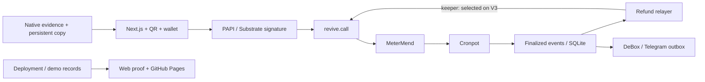

# MeterMend

**Every rental funds its next repair.**

[Logo kit](docs/BRAND.md) · [Progress report](docs/PROGRESS_REPORT.md)

Shared workshop equipment wears out without a repair budget.
Deposits become disputes, and operators cannot show where the money went.
MeterMend gives each item a protected repair reserve, recorded evidence and permissionless deposit refunds.

Built for **Portaldot Hacker House 2026 · Ecosystem DApps**. MeterMend implementation began on October 27, 2026, during the Hacker House build window. License: [MIT](LICENSE).

## Live on Portaldot V3

**MeterMend and both Cronpot versions are finalized on V3.** Corrected Cronpot deployed at block **317301**; MeterMend remains at its original address. The [direct-recovery demonstration](docs/LIVE_RECOVERY.md) completed refund, dispute, repair, income-only withdrawal and signed reserve-spending rejection. Rental 3 completed the corrected automatic-refund proof at block **322488**, with both JobExecuted(success=true) and DepositRefunded in the same finalized transaction.

Original Cronpot failed (OutOfGas, tx `0x2b9249a026b3f868527e6964de6bd5241f401942f28e247d82dfb0eac9d75e35`). The deposit was refunded directly (tx `0x53739d89deade004318a522a9517e97dc103432c73aad50f226cf6606ad523a7`). The corrected Cronpot then executed a live automatic refund (tx `0x8c45df7bebdaaa714c7490bac16538455196445eec253097b4d6a4e80b373b63`). [Original trace](deployments/cronpot-callback-diagnosis.json) · [Current demo receipts](deployments/demo-run.json).

| Contract           | V3 address                                   | Status                    |
| ------------------ | -------------------------------------------- | ------------------------- |
| Ping runtime probe | `0x96ee88d272550530b518cbaa15a80cf5d38cdcfd` | Deployed at block 213570  |
| Original Cronpot   | `0x41635a685448cfa86da1600656f103a211e398f4` | Finalized at block 265131 |
| Corrected Cronpot  | `0x232c9673766794d6106a68cf4480678c73658f4c` | Finalized at block 317301 |
| MeterMend          | `0x61382db168db646b899234cd707c7ba0142c4071` | Finalized at block 271379 |

Chain ID **420420777** (`0x190f1ca9`), runtime **3002**. [Deployment manifest](deployments/portaldot-v3.json) · [Funded probe evidence](deployments/funded-probe.json) · [Permanent proof report](https://willy264.github.io/portal_dot/) · [V3 node console](https://node-console.portaldot.dev/?rpc=wss%3A%2F%2Ftest-node-v3.portaldot.dev).

The [public web app](https://metermend.vercel.app/) and its [proof page](https://metermend.vercel.app/proof) are hosted on Vercel. Their deployment evidence distinguishes finalized contracts from the full live demonstration. The **demo video is pending**; the [keeper-mode recording script](docs/DEMO_VIDEO.md) targets two minutes and stays under 2:30. For local review, run `pnpm dev` and open `http://localhost:3000/proof`.

## What is implemented

- Item registration, QR rental, fee/reserve split, deposits, returns, disputes, approved repairs, operator income and item transfer.
- Cronpot's generic timed-call registry, with permissionless execution and bounded callbacks. Its keeper fallback is the selected V3 mode.
- A persistent finalized-event indexer and refund worker, with transaction journals and recovery states.
- Mobile web catalogue, operator dashboard, arbiter inbox, rental history, wallet activation, evidence verification, dark mode and proof pages.
- Durable community notifications with Telegram as the selected delivery channel. All six required event types have real Telegram acknowledgements; actual group screenshots remain pending. DeBox is the target integration and is not live.

The Foundry suite has **49 passing tests**, including fee-split fuzzing, reserve isolation, dispute voting, callback failures and transfer restrictions. TypeScript tests cover conversion, transaction outcomes, durable services, scheduling, evidence integrity and web data handling. The November 4 validation also passed 276 TypeScript/JavaScript tests, all typechecks and the production build. Live settlement receipts are separate evidence.

## Architecture



See [architecture and accounting flows](docs/ARCHITECTURE.md) and the authoritative [specification](SPEC.md).

## Why Portaldot

| Primitive              | MeterMend use                                  | Observed V3 behavior                                                                  |
| ---------------------- | ---------------------------------------------- | ------------------------------------------------------------------------------------- |
| Revive EVM execution   | Solidity enforces deposits, reserves and votes | EVM bytecode and Substrate-signed value movement verified                             |
| Native account mapping | Community wallets use Substrate accounts       | Funding automatically maps accounts; explicit mapping is disabled here                |
| Scheduler finding      | Signed-origin permission probe                 | P5 returned `BadOrigin`; native Scheduler does not execute this application's refunds |
| TransactionStorage     | Return and repair evidence                     | Signed 1 KB store succeeded; retention is 100800 blocks                               |
| Native events          | Item history and permanent proof               | Finalized events are persisted before public-node pruning                             |
| DeBox OpenAPI          | Community equipment and repair updates         | Integration implemented; credentials and live delivery pending                        |

refunds execute automatically via Cronpot; execution is permissionless and our keeper runs it.

MeterMend still creates its built-in job on the immutable original Cronpot. For the corrected demonstration, the keeper separately registers `MeterMend.finalizeRefund(rentalId)` on corrected Cronpot at the same `refundAt` deadline; the keeper then executes the due job. This external registration does not rewire MeterMend. The contract independently checks rental status and deadline. The operator's proposal plus either the distinct renter or arbiter approves a deduction; both other parties must reject to return the full deposit. Only an arbiter-approved repair can spend a reserve.

## Quickstart

Use Node **22.23.4**, pnpm **10.34.9** and Foundry **1.8.6**. Exact chain dependencies and committed metadata let CI build without a live metadata fetch.

```sh
pnpm install --frozen-lockfile
forge build --root contracts
pnpm contracts:abi
pnpm -r build
forge test --root contracts -vvv
pnpm -r test
```

Copy [.env.example](.env.example) to the ignored `.env`. Configure testnet-only signer seeds and service settings. `scripts/accounts.ts` creates fresh local demo accounts if needed and outputs only public addresses; never commit the resulting `.env`.

```sh
pnpm probe
pnpm tsx scripts/budget.ts
pnpm run deploy
pnpm seed
pnpm demo
pnpm dev
```

Scripts require sufficient funding and persist transactions as they finalize. Uncertain inclusion stops for reconciliation before any retry. Start the worker and optional bot in separate terminals:

```sh
pnpm --filter @metermend/cronpot-relayer start
pnpm --filter @metermend/debox-bot start
```

See [script operations](scripts/README.md) and [persistent hosting](docs/HOSTING.md). Vercel requires an external persistent evidence backend; serverless local disk is not durable storage.

For the corrected Cronpot recording keeper, run this from the repository root:

```powershell
powershell -NoProfile -ExecutionPolicy Bypass -File .\scripts\start-recording-keeper.ps1
```

The [free keeper setup](docs/HOSTING_FINAL.md) also prepares GitHub Actions attempts every ten minutes, with journal restoration and no overlapping signer. Scheduled runs can be delayed; configuration alone is not evidence of successful execution. The keeper can directly finalize eligible ordinary rentals lacking an active corrected job as a **permissionless direct fallback**; that produces a refund event, not successful Cronpot execution. The public rental page also offers **Finalize refund** after the deadline as a manual fallback.

## Phase 0 findings

| Check                   | Result                                                                      |
| ----------------------- | --------------------------------------------------------------------------- |
| V3 identity and pallets | Verified against the supplied endpoints and genesis                         |
| Compiler                | solc 0.8.30, Prague EVM bytecode accepted                                   |
| Units                   | Native 14 / EVM 18 decimals; funded movement verified factor 10000          |
| Constructors            | Append EVM constructor args to creation bytecode; native `data` stays empty |
| Native scheduler        | Signed request finalized with `BadOrigin`; use keeper mode                  |
| Evidence                | Signed 1 KB store succeeded; expiring storage plus application copy         |
| Raw EOA writes          | Not enabled; application writes use Substrate signatures                    |

[Detailed decisions](docs/DECISIONS.md) distinguish simulations from funded transactions. Compiled deployment estimates total **1187.49 tPOT** in storage deposits, before fees and demo state. [Funding request and evidence](docs/FAUCET_REQUEST.md).

## Known limitations and submission status

The indexer is behind the live chain; retained transaction proofs and direct contract reads remain available, but the history feed is incomplete.

Humans assess damage. Missing dispute votes can leave deposits unresolved; a contract renter refusing a push refund can also prevent settlement. Ownership stays locked until deposits close. Cancelled Cronpot tips received by MeterMend remain unallocated dust.

The testnet prunes history, so the worker must stay online or report a gap. Native evidence expires unless renewed. DeBox wallet-chain support is separate from its bot API; notifications do not imply its embedded wallet can sign V3 transactions. Notification delivery is at-least-once across ambiguous provider responses.

The distinct demo roles are funded and mapped, and two items have 120-second dispute windows. The [printable QR sheet](https://metermend.vercel.app/metermend-qr.html) remains valid because MeterMend and the item registrations are unchanged. The corrected Cronpot passes 49 contract tests and is now deployed. The November 3 direct recovery spent 73.23301569451228 tPOT under its separate 83.49 tPOT cap; the subsequent corrected-Cronpot deployment and rehearsal are recorded separately. Paid hosting was declined: the selected setup is free GitHub Actions plus a local recording keeper. Render remains a free read-only history preview; it does not provide durable public evidence uploads. Physical-phone rehearsal, actual Telegram group screenshots, video upload and final BUIDL submission remain outstanding.

## Research archive

The original [research report and twelve proposals](PORTALDOT_RESEARCH_AND_IDEAS.md) includes three ideas per track, technology findings and partner integration options. Supporting evidence remains in [research/](research/). MeterMend is the selected build.
