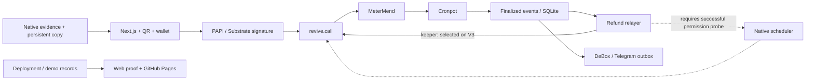

# MeterMend

**Every rental funds its next repair.**

Shared workshop equipment wears out without a repair budget.
Deposits become disputes, and operators cannot show where the money went.
MeterMend gives each item a protected repair reserve, recorded evidence and permissionless deposit refunds.

Built for **Portaldot Hacker House 2026 · Ecosystem DApps**. MeterMend implementation began on October 27, 2026, during the Hacker House build window. License: [MIT](LICENSE).

## Live on Portaldot V3

The **runtime probe is live; application deployment is pending additional test tokens**. The probe is not a completed MeterMend demo.

| Contract           | V3 address                                   | Status                                        |
| ------------------ | -------------------------------------------- | --------------------------------------------- |
| Ping runtime probe | `0x96ee88d272550530b518cbaa15a80cf5d38cdcfd` | Deployed at block 213570                      |
| Cronpot            | Pending                                      | Compiled and tested; storage funding required |
| MeterMend          | Pending                                      | Compiled and tested; storage funding required |

Chain ID **420420777** (`0x190f1ca9`), runtime **3002**. [Deployment manifest](deployments/portaldot-v3.json) · [Funded probe evidence](deployments/funded-probe.json) · [Permanent proof report](https://willy264.github.io/portal_dot/) · [V3 node console](https://node-console.portaldot.dev/?rpc=wss%3A%2F%2Ftest-node-v3.portaldot.dev).

The [public web app](https://metermend.vercel.app/) and its [proof page](https://metermend.vercel.app/proof) are hosted on Vercel. They distinguish the live runtime probe from the application contracts still awaiting funding. The **two-minute demo video is pending**; the [keeper-mode recording script](docs/DEMO_VIDEO.md) lists the required live shots. For local review, run `pnpm dev` and open `http://localhost:3000/proof`.

## What is implemented

- Item registration, QR rental, fee/reserve split, deposits, returns, disputes, approved repairs, operator income and item transfer.
- Cronpot's generic timed-call registry, with permissionless execution and bounded callbacks. Its keeper fallback is the selected V3 mode.
- A persistent finalized-event indexer and refund worker, with transaction journals and recovery states.
- Mobile web catalogue, operator dashboard, arbiter inbox, rental history, wallet activation, evidence verification, dark mode and proof pages.
- Durable DeBox notifications and a Telegram fallback. Live delivery remains unconfigured until credentials and a destination are supplied.

The Foundry suite has **43 passing tests**, including fee-split fuzzing, reserve isolation, dispute voting, callback failures and transfer restrictions. TypeScript tests cover conversion, transaction outcomes, durable services, scheduling, evidence integrity and web data handling. These checks are separate from the pending full live demonstration.

## Architecture



See [architecture and accounting flows](docs/ARCHITECTURE.md) and the authoritative [specification](SPEC.md).

## Why Portaldot

| Primitive              | MeterMend use                                  | Observed V3 behavior                                                           |
| ---------------------- | ---------------------------------------------- | ------------------------------------------------------------------------------ |
| Revive EVM execution   | Solidity enforces deposits, reserves and votes | EVM bytecode and Substrate-signed value movement verified                      |
| Native account mapping | Community wallets use Substrate accounts       | Funding automatically maps accounts; explicit mapping is disabled here         |
| Scheduler              | Optional chain-native Cronpot execution        | A signed request returned `BadOrigin`; keeper mode is required for this origin |
| TransactionStorage     | Return and repair evidence                     | Signed 1 KB store succeeded; retention is 100800 blocks                        |
| Native events          | Item history and permanent proof               | Finalized events are persisted before public-node pruning                      |
| DeBox OpenAPI          | Community equipment and repair updates         | Integration implemented; credentials and live delivery pending                 |

Cronpot supplies liveness, not refund authority. `finalizeRefund` independently checks rental status and the deadline. The operator's proposal plus either the distinct renter or arbiter approves a deduction; both other parties must reject to return the full deposit. Only an arbiter-approved repair can spend a reserve.

## Quickstart

Use Node **22.23.4**, pnpm **10.34.9** and Foundry **1.8.6**. Exact chain dependencies and committed metadata let CI build without a live metadata fetch.

```sh
pnpm install --frozen-lockfile
forge build --root contracts
pnpm contracts:abi
pnpm -r build
forge test --root contracts -vvv
pnpm -r test
```

Copy [.env.example](.env.example) to the ignored `.env`. Configure testnet-only signer seeds and service settings. `scripts/accounts.ts` creates fresh local demo accounts if needed and outputs only public addresses; never commit the resulting `.env`.

```sh
pnpm probe
pnpm tsx scripts/budget.ts
pnpm run deploy
pnpm seed
pnpm demo
pnpm dev
```

Scripts require sufficient funding and persist transactions as they finalize. Uncertain inclusion stops for reconciliation before any retry. Start the worker and optional bot in separate terminals:

```sh
pnpm --filter @metermend/cronpot-relayer start
pnpm --filter @metermend/debox-bot start
```

See [script operations](scripts/README.md) and [persistent hosting](docs/HOSTING.md). Vercel requires an external persistent evidence backend; serverless local disk is not durable storage.

## Phase 0 findings

| Check                   | Result                                                                      |
| ----------------------- | --------------------------------------------------------------------------- |
| V3 identity and pallets | Verified against the supplied endpoints and genesis                         |
| Compiler                | solc 0.8.30, Prague EVM bytecode accepted                                   |
| Units                   | Native 14 / EVM 18 decimals; funded movement verified factor 10000          |
| Constructors            | Append EVM constructor args to creation bytecode; native `data` stays empty |
| Native scheduler        | Signed request finalized with `BadOrigin`; use keeper mode                  |
| Evidence                | Signed 1 KB store succeeded; expiring storage plus application copy         |
| Raw EOA writes          | Not enabled; application writes use Substrate signatures                    |

[Detailed decisions](docs/DECISIONS.md) distinguish simulations from funded transactions. Compiled deployment estimates total **1187.49 tPOT** in storage deposits, before fees and demo state. [Funding request and evidence](docs/FAUCET_REQUEST.md).

## Known limitations and submission status

Humans assess damage. Missing dispute votes can leave deposits unresolved; a contract renter refusing a push refund can also prevent settlement. Ownership stays locked until deposits close. Cancelled Cronpot tips received by MeterMend remain unallocated dust.

The testnet prunes history, so the worker must stay online or report a gap. Native evidence expires unless renewed. DeBox wallet-chain support is separate from its bot API; notifications do not imply its embedded wallet can sign V3 transactions. Notification delivery is at-least-once across ambiguous provider responses.

Additional test tokens, a persistent worker/evidence host and bot credentials are needed for the full live golden path, public QR rental demonstration and video. The web interface and permanent report are public. Reserve isolation passes in Foundry; `pnpm demo` will record its live proof. No submitted BUIDL or uploaded video is claimed yet.

## Research archive

The original [research report and twelve proposals](PORTALDOT_RESEARCH_AND_IDEAS.md) includes three ideas per track, technology findings and partner integration options. Supporting evidence remains in [research/](research/). MeterMend is the selected build.
