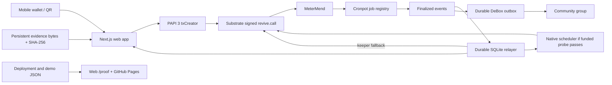

# MeterMend architecture

## Funds and permissions

A rental atomically splits its fee into the item's reserve and the operator's withdrawable income. Its deposit remains a separate liability. A physical return frees the item for reuse and starts a dispute window; financial closure decrements the unsettled-rental counter. Ownership cannot change while any deposit remains unsettled.

The operator's damage proposal is one approval. Either the distinct renter or arbiter may supply the second approval. Both must reject to deny the deduction. Approved deductions replenish the item's reserve. A repair payout requires an operator proposal and arbiter approval; income withdrawal cannot access reserves.

Cronpot changes liveness, not permission to receive funds. MeterMend checks rental status and chain timestamp on every finalization. Anybody can finalize directly when permitted. A cancelled, delayed or failed job cannot override a dispute. Cronpot uses a bounded target call, checks adequate outer gas and defers tips when an executor refuses payment.

## Persistence and recovery

Only finalized blocks advance the ingestion cursor. Events and the cursor are written in one SQLite transaction. A missing/pruned block stops ingestion with an explicit history gap; the service never silently skips it. Derived jobs and messages are replayable from durable input. Bot state, bounded outbox entries and the processed cursor commit together.

Notifications are at-least-once. Ordinary restarts/replays are deduplicated, but a provider accepting a message and losing its HTTP response can produce a retry duplicate. DeBox delivery observes both one message/second and the ordinary five/rolling-minute quota, including backoff. Delivery failures do not stop queued work or destroy history.

Transactions with ambiguous inclusion must be reconciled by hash before a value transfer is retried. Seeds exist only in ignored local/server environment files. Browser extensions sign their own accounts. Public proof records contain addresses and transaction evidence only.

## Evidence hosting

The browser hashes exactly the bytes it stores. Displayed evidence is verified against that hash. Native TransactionStorage is enabled only after a funded size/cost probe succeeds; hash-only mode uses persistent app storage. Vercel hosting requires a persistent evidence backend, because serverless local disk does not survive deployment/restarts.

## Runtime decisions

See [DECISIONS.md](DECISIONS.md) and [probe.json](../deployments/probe.json). Successful simulations do not establish funded execution, native scheduler permission or a deployed contract. The live demo and proof pages must preserve that distinction.
