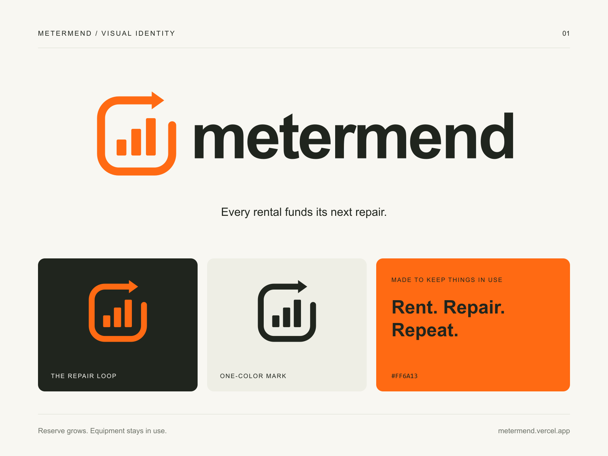

# MeterMend logo

The mark combines a rising repair-reserve meter with a returning repair loop. Each rental grows a protected reserve; approved repairs keep the equipment in use. Its three bars extend the meter motif already used in the interface.

## Files

All production artwork is in [apps/web/public/brand](../apps/web/public/brand/). SVG wordmarks use outlined letters, so they do not require a font download. PNG wordmarks have transparent backgrounds and are 2400 pixels wide. Marks and the app icon are 1024 pixels square.

| File                                                                                                                              | Use                                                  |
| --------------------------------------------------------------------------------------------------------------------------------- | ---------------------------------------------------- |
| [logo.svg](../apps/web/public/brand/logo.svg) / [logo.png](../apps/web/public/brand/logo.png)                                     | Primary orange-and-ink wordmark on light backgrounds |
| [logo-reversed.svg](../apps/web/public/brand/logo-reversed.svg) / [logo-reversed.png](../apps/web/public/brand/logo-reversed.png) | Orange-and-paper wordmark on dark backgrounds        |
| [logo-mono.svg](../apps/web/public/brand/logo-mono.svg) / [logo-mono.png](../apps/web/public/brand/logo-mono.png)                 | Single-color printing                                |
| [logo-white.svg](../apps/web/public/brand/logo-white.svg) / [logo-white.png](../apps/web/public/brand/logo-white.png)             | White wordmark on a dark or colored field            |
| [mark.svg](../apps/web/public/brand/mark.svg) / [mark.png](../apps/web/public/brand/mark.png)                                     | Standalone repair-loop symbol                        |
| [mark-mono.svg](../apps/web/public/brand/mark-mono.svg) / [mark-mono.png](../apps/web/public/brand/mark-mono.png)                 | Single-color symbol                                  |
| [icon.svg](../apps/web/public/brand/icon.svg) / [icon.png](../apps/web/public/brand/icon.png)                                     | Square profile/app icon                              |
| [preview.png](../apps/web/public/brand/preview.png)                                                                               | Presentation board; not a transparent logo           |

The favicon and 180-pixel Apple touch icon are included. The web header and footer use the primary/reversed SVGs, selected by the existing theme toggle.

## Use

Colors: safety orange `#FF6A13`, ink `#20251E`, warm paper `#F8F7F2`. Keep the artwork's proportions and leave clear space at least one bar-width around the symbol. Use the standalone mark below a 120-pixel wordmark width. Use the ink or white variant where a single printing color is required. Avoid adding gradients, shadows or outlines to the production logo.

## Design brief and production

“Create a simple MeterMend logo that matches the workshop-ledger interface: a rising repair-reserve meter enclosed by a returning repair loop, safety orange with ink-black type and warm off-white, readable at small sizes, with the exact lowercase wordmark ‘metermend’. Supply transparent masters and light, dark, monochrome and icon versions.”

The artwork was authored directly as vector paths to extend the existing interface's meter motif. No image-generation API was used. The wordmark outlines were derived from the interface's Arial Bold lettering; no font software is distributed. The SVGs are the editable masters. Re-export PNGs with `node scripts/export-brand.mjs`, which uses the existing Next.js Sharp dependency.
